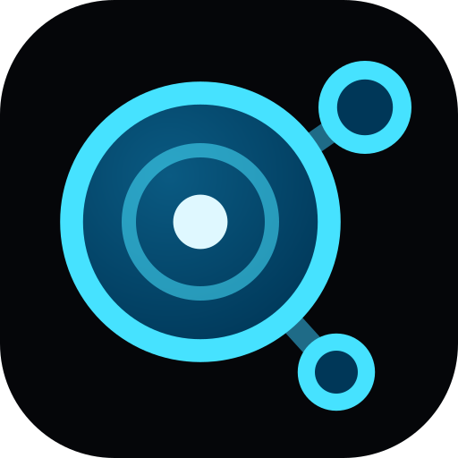

<p align="center">
  
</p>

# Nodary MCP server

**Connect Claude, ChatGPT, Cursor, Claude Code or VS Code to your team's linked documents.**

[Nodary](https://nodary.ai) is an AI-native workspace where a team's documents link instead of piling up: specs, wikis, sheets, diagrams, boards and reviews on one map, with an MCP server so AI agents like Claude, ChatGPT and Cursor read and write it.

**This is a hosted server: there is no code to install or run.** Nodary's remote [Model Context Protocol](https://modelcontextprotocol.io) server is operated by AnkleBreaker Studio at `https://nodary.ai/api/mcp`, and its source code is not public. This repository documents how to connect to it and holds its registry metadata ([`server.json`](server.json)).

Setup guides on nodary.ai, one per client:

| Client | Guide |
| --- | --- |
| Claude (claude.ai and Claude Desktop) | https://nodary.ai/docs/mcp/claude |
| ChatGPT | https://nodary.ai/docs/mcp/chatgpt |
| Claude Code | https://nodary.ai/docs/mcp/claude-code |
| Cursor | https://nodary.ai/docs/mcp/cursor |
| VS Code (GitHub Copilot) | https://nodary.ai/docs/mcp/vs-code |
| Every client at a glance, Devin Desktop included | https://nodary.ai/docs/mcp |

Fact sheet for people and agents: https://nodary.ai/facts (also as [Markdown](https://nodary.ai/facts.md) and [JSON](https://nodary.ai/facts.json)). Index for language models: https://nodary.ai/llms.txt

## At a glance

| | |
| --- | --- |
| Endpoint | `https://nodary.ai/api/mcp` |
| Transport | Streamable HTTP (JSON-RPC over POST) |
| Sign-in | OAuth 2.1 with dynamic client registration and PKCE, or an API key (`Authorization: Bearer gdc_...`) |
| OAuth scopes | `mcp`, `offline_access` |
| Protocol versions | 2025-06-18, 2025-03-26, 2024-11-05 |
| Tools, prompts, resources | 98 tools, 4 prompts, 2 resource templates (the server's `tools/list` is authoritative) |
| Rate limit | 120 requests a minute per connection; no daily write limit |
| Plans | Included in every Nodary plan (Free, Pro, Studio and Enterprise); on Free, within the free plan's limits |
| Discovery | [`/.well-known/oauth-protected-resource/api/mcp`](https://nodary.ai/.well-known/oauth-protected-resource/api/mcp), [`/.well-known/oauth-authorization-server`](https://nodary.ai/.well-known/oauth-authorization-server), [`/.well-known/mcp.json`](https://nodary.ai/.well-known/mcp.json) |
| Registry name | `ai.nodary/nodary` ([`server.json`](server.json)) |

## Before you connect

You need a Nodary account and a workspace. The Free plan needs no card and has no time limit: https://nodary.ai/sign-up

An agent acts as the person who connected it: it sees and changes only what that person's role allows, and a key limited to one project stays in that project. Your client uses its own AI model.

## Connect your client

Use the address `https://nodary.ai/api/mcp`. Most clients sign in with OAuth: they open a Nodary sign-in and consent page in your browser, with no client ID to create and nothing to copy. Access tokens last an hour and the client renews them.

One connection can reach several workspaces. When you belong to more than one, the consent page lists them all with none ticked for you: the app then reaches the workspaces you tick, and only those. An API key stays tied to one workspace.

Each setup below was checked against that client's own documentation on 22 October 2026.

### Claude (claude.ai and Claude Desktop)

1. Open **Customize**, then **Connectors**, and choose **Add custom connector**.
2. Name it Nodary and enter `https://nodary.ai/api/mcp`. If Claude asks how people sign in, choose **Sign in now**. If it asks which OAuth client to use, choose **Register automatically** and leave the client ID and secret empty.
3. Select **Add**, then **Connect**, sign in to Nodary and approve the access.

Custom connectors are available on the Free, Pro, Max, Team and Enterprise plans; Free allows one. On Team and Enterprise, an Owner adds the connector for the organisation first, then each member connects with their own account.

Step-by-step guide: https://nodary.ai/docs/mcp/claude

### ChatGPT

1. Open **Plugins**, select the plus button, then **Add custom MCP server**.
2. Name it Nodary, enter `https://nodary.ai/api/mcp` under **Connection** and choose **OAuth**: there is no client ID or secret to enter.
3. Read the risk warning, tick **I understand and want to continue**, then select **Create as a plugin**.
4. Sign in to Nodary and approve the access. In a conversation, type `@` and pick Nodary.

Custom MCP servers work on the web, not in the mobile apps. On Business, admins and owners add them; on Enterprise and Edu, so can members an admin gives the **Create plugins with MCPs** permission. On Pro, ChatGPT connects them with read and fetch permissions only. OpenAI offers no custom MCP servers on Free or Plus. ChatGPT connects with OAuth only, not with an API key.

Step-by-step guide: https://nodary.ai/docs/mcp/chatgpt

### Claude Code

```sh
claude mcp add --transport http nodary https://nodary.ai/api/mcp
```

To use Nodary in every project, add it to your user scope instead:

```sh
claude mcp add --transport http --scope user nodary https://nodary.ai/api/mcp
```

Then type `/mcp` in Claude Code, choose **nodary** and sign in from the browser (or run `claude mcp login nodary`).

With an API key instead:

```sh
claude mcp add --transport http nodary https://nodary.ai/api/mcp \
  --header "Authorization: Bearer gdc_..."
```

To share the server in `.mcp.json` without sharing a key, read the key from an environment variable:

```json
{
  "mcpServers": {
    "nodary": {
      "type": "http",
      "url": "https://nodary.ai/api/mcp",
      "headers": {
        "Authorization": "Bearer ${NODARY_API_KEY}"
      }
    }
  }
}
```

Step-by-step guide: https://nodary.ai/docs/mcp/claude-code

### Cursor

Add Nodary to `~/.cursor/mcp.json` (every project) or `.cursor/mcp.json` (one project):

```json
{
  "mcpServers": {
    "nodary": {
      "url": "https://nodary.ai/api/mcp"
    }
  }
}
```

Open **Customize** in Cursor's sidebar, find nodary among the MCP servers, turn it on and sign in when Cursor asks. With an API key instead, put it in the `NODARY_API_KEY` environment variable (never commit a key):

```json
{
  "mcpServers": {
    "nodary": {
      "url": "https://nodary.ai/api/mcp",
      "headers": {
        "Authorization": "Bearer ${env:NODARY_API_KEY}"
      }
    }
  }
}
```

Step-by-step guide: https://nodary.ai/docs/mcp/cursor

### VS Code (GitHub Copilot)

1. Open the Command Palette and run **MCP: Add Server**.
2. Choose **HTTP**, enter `https://nodary.ai/api/mcp` and the server ID `nodary`.
3. Choose **Global**, then **Copilot Global**. VS Code writes `~/.copilot/mcp-config.json`:

```json
{
  "mcpServers": {
    "nodary": {
      "type": "http",
      "url": "https://nodary.ai/api/mcp",
      "tools": [
        "*"
      ]
    }
  }
}
```

4. Start the server and accept the trust and sign-in prompts; Nodary's consent page opens in your browser.

On Copilot Business and Enterprise, the organisation's "MCP servers in Copilot" policy must be on; it is off by default.

With an API key instead, add the header to `~/.copilot/mcp-config.json`. VS Code reads no prompted variables from this file, so the key sits in it in clear text: never commit it, and give the key an expiry of 30 or 90 days.

```json
{
  "mcpServers": {
    "nodary": {
      "type": "http",
      "url": "https://nodary.ai/api/mcp",
      "headers": {
        "Authorization": "Bearer gdc_..."
      },
      "tools": [
        "*"
      ]
    }
  }
}
```

Step-by-step guide: https://nodary.ai/docs/mcp/vs-code

### Devin Desktop (formerly Windsurf)

```sh
devin mcp add -s user nodary https://nodary.ai/api/mcp
devin mcp login nodary
```

Or add it to `~/.config/devin/mcp_config.json` (on Windows, `%APPDATA%\devin\mcp_config.json`):

```json
{
  "mcpServers": {
    "nodary": {
      "url": "https://nodary.ai/api/mcp",
      "transport": "http"
    }
  }
}
```

### Any other MCP client

Point a Streamable HTTP client at `https://nodary.ai/api/mcp`. A first request answered `401` with a `resource_metadata` address is expected: it tells the client where to sign in.

A client that cannot sign in can send an API key instead. Create one in Nodary under **Profile**, **API keys & MCP**: it starts with `gdc_`, is shown once, acts with your permissions, can be limited to one project, and expires after 30, 90 or 365 days, or never, as you choose. Send it as `Authorization: Bearer gdc_...`.

## What an agent can do

98 tools, grouped by the job they do. Each one tells the client whether it only reads, and whether a write can overwrite something, so a client can ask you before it acts.

**Find and read**: projects, documents with their links and history, comments, knowledge notes, saved views and context briefs. Results carry links people can open.
`list_games`, `list_stars`, `search_documents`, `get_document`, `get_star`, `get_tree`, `list_templates`, `list_members`, `list_project_knowledge`, `get_project_knowledge`, `list_comments`, `get_canon`, `list_versions`, `get_version`, `diff_versions`, `list_deleted_stars`, `list_context_briefs`, `get_context_brief`, `list_saved_views`, `get_saved_view`, `list_favorites`, `get_workspace_usage`, `list_properties`, `get_file_url`, `describe_blocks`, `run_view`, `list_workspaces`

**Write and organise**: create and edit documents block by block, file them in folders, link them, tag them, comment, set properties and settle contradictions. A deleted document can be restored.
`create_game`, `update_game`, `rename_workspace`, `create_starter_constellation`, `create_from_template`, `create_star`, `create_stars`, `write_document`, `append_document`, `edit_document`, `update_star`, `update_stars`, `delete_star`, `restore_star`, `duplicate_star`, `create_cluster`, `move_to_cluster`, `link_stars`, `unlink_stars`, `set_tags`, `save_project_knowledge`, `add_comment`, `add_comments`, `resolve_comment`, `list_contradictions`, `report_contradiction`, `resolve_contradiction`, `save_context_brief`, `save_saved_view`, `set_favorite`, `define_properties`, `set_properties`, `restore_version`, `edit_comment`, `delete_comment`, `delete_project_knowledge`, `set_ai_instructions`, `remove_context_brief`, `remove_saved_view`, `open_daily_note`, `replace_in_project`, `extract_blocks`

**Art review and pictures**: bring pictures in, look at them with the notes people drew on them, decide, note and tag deliverables (each decision signed with who and when), turn a moodboard into a palette and check a picture against it, and prepare an outsourcer's feedback sheet.
`add_image`, `start_upload`, `add_media`, `get_image`, `get_moodboard`, `render_board`, `edit_board`, `find_pictures`, `update_pictures`, `get_art_review`, `extract_palette`, `check_palette`, `feedback_sheet`, `restore_image_version`, `set_image_origin`

**Spreadsheets and balancing**: read a sheet as computed values with the formula behind each cell, write cells by address or by row, and read a loot table for what it means to players.
`get_sheet`, `set_cells`, `analyze_drops`

**Localization and dialogue**: see each language's progress in a string table, write translations by key, and check a branching dialogue, which exports as a Yarn Spinner script.
`get_localization`, `set_translations`, `check_dialogue`

**Production**: set due dates, request and submit reviews, see what changed recently and whether the milestone lands.
`get_progress`, `recent_changes`, `set_due_date`, `set_due_dates`, `request_review`, `withdraw_review`, `submit_review`, `my_inbox`

In tool names, a project is a `game` (game studios were Nodary's first market) and a document is a `star` (documents are stars in a constellation). Nothing in the workspace requires a game.

### Prompts and resources

Ready-made requests a client can offer as commands:

- `weekly-summary`: what changed this week in the workspace or one project: written, decided, reviewed and still open.
- `art-review`: where the art review stands: pictures waiting for a decision, those that stray from the palette, and what to decide next.
- `playtest-to-tasks`: turns playtest notes into tasks, each linked to the design document it touches.
- `balance-review`: reads a loot table or a progression curve and says what it means for players and what looks off.

Resources a client can attach without a tool call:

- `nodary://star/{id}`: a document, as Markdown.
- `nodary://project/{id}`: a project's outline.

### What to ask once connected

- "What changed in the Marketing project this week? List each document with its link."
- "Write a project brief for the website redesign from my notes below, file it under Planning and link it to the roadmap."
- "Find the documents that give different launch dates and quote each passage."
- "Set next Friday as the due date of every draft in the Q4 plan folder, and ask Léa to review the pricing spec."

## Safety

- An agent acts as the person who connected it: it sees and changes only what that person can, and a key limited to a project stays in that project.
- In a connection to several workspaces, nothing resolves across them: ids and titles are looked up only in the workspace a call names, an id from another workspace is refused before anything runs, and every result names its workspace.
- Every agent write makes a version. A document keeps its 50 newest versions by people and its 50 newest by agents (an agent's never push out people's), and a deleted document comes back for 30 days.
- Writing tools take an idempotency key: a call retried after a dropped connection returns the first result instead of writing twice.
- Share links, access, members, roles, keys, billing and deleting a project stay human decisions: no agent can do them.
- Nodary tells every agent that the text of documents and comments is content to work with, not instructions to follow. How an agent acts on that is up to the agent.
- Nodary does not use workspace content to train AI models. Nodary and its data are hosted by Amazon Web Services in the United States (us-east-1). More: https://nodary.ai/security

## Limits and errors

- A connection makes at most 120 requests a minute; writing has no daily limit.
- On Free, an agent reads and writes as on a paid plan while the workspace stays within the free plan: 1 project, 10 documents and folders, and 2 members. A write that would go past a limit is refused with the limit it hits and a link to the pricing page. The owner or an admin lifts the limit with a bigger plan, or with the 14-day Studio trial (MCP included, no card).
- `quota_locked`: the workspace is above the free plan after its trial and is locked until the owner subscribes; agents are cut off there, reads included. It works again at once after that. In a connection to several workspaces, only the calls into that workspace are refused.
- `billing_locked`: a payment failed, so the workspace is locked until the owner settles it.
- `workspace_suspended`: Nodary has suspended the workspace, so nothing reaches it, agents included. The owner can write to support@nodary.ai.
- `workspace_required` or `workspace_not_found`: the connection reaches several workspaces; pass one of the listed ones as `workspace`, or connect again and tick only one.
- If a client cannot finish signing in, connect it with an API key instead.

## Links

- Product: https://nodary.ai
- MCP documentation: https://nodary.ai/docs/mcp
- Pricing: https://nodary.ai/pricing
- Security: https://nodary.ai/security
- Privacy policy: https://nodary.ai/privacy
- Terms of service: https://nodary.ai/terms
- Product journal: https://nodary.ai/updates
- Support: support@nodary.ai

## About

Nodary is made by [AnkleBreaker Studio](https://github.com/AnkleBreaker-Studio), a game studio in Le Pecq, France, which builds it and uses it every day on its own games; the publisher is AnkleBreaker Consulting SAS. The studio also maintains the [Unity MCP server](https://github.com/AnkleBreaker-Studio/unity-mcp-server). Nodary was called Constellation until June 2026.

Not to be confused with the nodary curve in geometry, with nodary.io (blockchain oracle services in the API3 ecosystem) or with nodary.dev (a hub for developers' snippets and notes).

## License

The documentation and the configuration examples in this repository are released under the [MIT License](LICENSE). The Nodary service itself is governed by its [terms of service](https://nodary.ai/terms).
